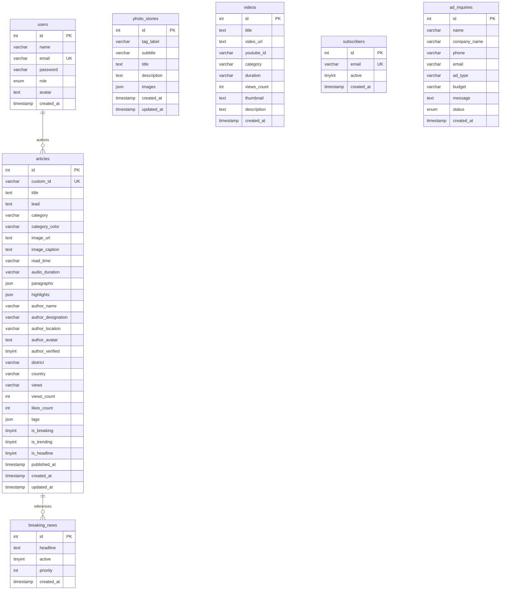

# Kerala Desam (കേരളദേശം) – Database Documentation

This document describes the database design, schema definitions, relationships, indexes, and persistence strategy for the Kerala Desam platform.

---

## 1. Database Overview

- **RDBMS Engine**: MySQL 8.0+ / MariaDB 10.5+
- **Default Database Name**: `keraladesam_db`
- **Default Character Set**: `utf8mb4` (Full Unicode support including Malayalam scripts and emojis)
- **Collation**: `utf8mb4_unicode_ci`
- **Storage Engine**: `InnoDB` (Row-level locking, foreign key integrity, ACID compliance)
- **Driver**: `mysql2` (Connection pooling with keep-alive queries)

---

## 2. Entity-Relationship Diagram (ERD)

---

## 3. Schema Definitions

### 3.1 `users` Table
Stores authentication credentials and permissions for administrative personnel and staff journalists.

| Column | Data Type | Constraints | Default | Description |
| :--- | :--- | :--- | :--- | :--- |
| `id` | `INT` | `AUTO_INCREMENT`, `PRIMARY KEY` | N/A | Unique user identifier |
| `name` | `VARCHAR(255)` | `NOT NULL` | N/A | Full name of editor |
| `email` | `VARCHAR(255)` | `NOT NULL`, `UNIQUE` | N/A | Login email address |
| `password` | `VARCHAR(255)` | `NOT NULL` | N/A | Bcrypt hashed password |
| `role` | `ENUM('admin','editor')` | `NULL` | `'editor'` | Authorization level |
| `avatar` | `TEXT` | `NULL` | `NULL` | Profile picture URL |
| `created_at` | `TIMESTAMP` | `NULL` | `CURRENT_TIMESTAMP` | Account creation date |

---

### 3.2 `articles` Table
Stores published journalism articles, editorial features, and district reports.

| Column | Data Type | Constraints | Default | Description |
| :--- | :--- | :--- | :--- | :--- |
| `id` | `INT` | `AUTO_INCREMENT`, `PRIMARY KEY` | N/A | Numeric primary key |
| `custom_id` | `VARCHAR(100)` | `NULL`, `INDEX` | `NULL` | Unique slug identifier |
| `title` | `TEXT` | `NOT NULL` | N/A | Malayalam news headline |
| `lead` | `TEXT` | `NULL` | `NULL` | Introductory lead paragraph |
| `category` | `VARCHAR(100)` | `NOT NULL`, `INDEX` | N/A | News category name |
| `category_color` | `VARCHAR(50)` | `NULL` | `'#006b9a'` | Theme accent color hex |
| `image_url` | `TEXT` | `NULL` | `NULL` | Primary hero image URL |
| `image_caption` | `TEXT` | `NULL` | `NULL` | Photo credit / caption |
| `read_time` | `VARCHAR(50)` | `NULL` | `'3 മിനിറ്റ് വായന'` | Estimated reading time |
| `audio_duration` | `VARCHAR(20)` | `NULL` | `'03:00'` | TTS audio narration duration |
| `paragraphs` | `JSON` | `NULL` | `NULL` | Array of story paragraphs |
| `highlights` | `JSON` | `NULL` | `NULL` | Array of key bullet points |
| `author_name` | `VARCHAR(255)` | `NULL` | `'പ്രത്യേക ലേഖകൻ'` | Reporter name |
| `author_designation`| `VARCHAR(100)` | `NULL` | `'എഡിറ്റർ'` | Author title |
| `author_location` | `VARCHAR(100)` | `NULL` | `'തിരുവനന്തപുരം'` | Reporting bureau location |
| `author_avatar` | `TEXT` | `NULL` | `NULL` | Reporter avatar image |
| `author_verified` | `TINYINT(1)` | `NULL` | `1` | Verified journalist badge |
| `district` | `VARCHAR(100)` | `NULL`, `INDEX` | `NULL` | Kerala district tag |
| `country` | `VARCHAR(100)` | `NULL` | `'India'` | Country tag (e.g. UAE) |
| `views` | `VARCHAR(50)` | `NULL` | `'1.2k'` | Display string for views |
| `views_count` | `INT` | `NULL` | `100` | Metric counter for views |
| `likes_count` | `INT` | `NULL` | `0` | Metric counter for likes |
| `tags` | `JSON` | `NULL` | `NULL` | Search & SEO tags |
| `is_breaking` | `TINYINT(1)` | `NULL`, `INDEX` | `0` | Flag for breaking story |
| `is_trending` | `TINYINT(1)` | `NULL`, `INDEX` | `0` | Flag for trending stories |
| `is_headline` | `TINYINT(1)` | `NULL`, `INDEX` | `0` | Top pinned lead story |
| `published_at` | `TIMESTAMP` | `NULL` | `CURRENT_TIMESTAMP` | Editorial publication time |
| `created_at` | `TIMESTAMP` | `NULL` | `CURRENT_TIMESTAMP` | Row creation timestamp |
| `updated_at` | `TIMESTAMP` | `NULL` | `CURRENT_TIMESTAMP ON UPDATE` | Last modification time |

---

### 3.3 `breaking_news` Table
Stores short marquee alerts for the ticker strip.

| Column | Data Type | Constraints | Default | Description |
| :--- | :--- | :--- | :--- | :--- |
| `id` | `INT` | `AUTO_INCREMENT`, `PRIMARY KEY` | N/A | Alert identifier |
| `headline` | `TEXT` | `NOT NULL` | N/A | Ticker text in Malayalam |
| `active` | `TINYINT(1)` | `NULL`, `INDEX` | `1` | Visibility toggle (1/0) |
| `priority` | `INT` | `NULL` | `0` | Order weight (lower = first) |
| `created_at` | `TIMESTAMP` | `NULL` | `CURRENT_TIMESTAMP` | Alert timestamp |

---

### 3.4 `videos` Table
Stores video shorts, reels, and YouTube embeds.

| Column | Data Type | Constraints | Default | Description |
| :--- | :--- | :--- | :--- | :--- |
| `id` | `INT` | `AUTO_INCREMENT`, `PRIMARY KEY` | N/A | Video identifier |
| `title` | `TEXT` | `NOT NULL` | N/A | Video title |
| `video_url` | `TEXT` | `NOT NULL` | N/A | Video stream or YouTube URL |
| `youtube_id` | `VARCHAR(100)` | `NULL` | `NULL` | YouTube 11-char ID |
| `category` | `VARCHAR(100)` | `NULL` | `'പ്രത്യേകം'` | Video category |
| `duration` | `VARCHAR(50)` | `NULL` | `'02:30'` | Runtime duration |
| `views_count` | `INT` | `NULL` | `100` | Metric views counter |
| `thumbnail` | `TEXT` | `NULL` | `NULL` | Cover poster image URL |
| `description` | `TEXT` | `NULL` | `NULL` | Video summary |
| `created_at` | `TIMESTAMP` | `NULL` | `CURRENT_TIMESTAMP` | Ingestion timestamp |

---

### 3.5 `subscribers` Table
Manages reader email subscriptions.

| Column | Data Type | Constraints | Default | Description |
| :--- | :--- | :--- | :--- | :--- |
| `id` | `INT` | `AUTO_INCREMENT`, `PRIMARY KEY` | N/A | Subscriber identifier |
| `email` | `VARCHAR(255)` | `NOT NULL`, `UNIQUE` | N/A | Verified email address |
| `active` | `TINYINT(1)` | `NULL` | `1` | Subscription status |
| `created_at` | `TIMESTAMP` | `NULL` | `CURRENT_TIMESTAMP` | Subscription date |

---

### 3.6 `ad_inquiries` Table
Stores inbound advertiser inquiries.

| Column | Data Type | Constraints | Default | Description |
| :--- | :--- | :--- | :--- | :--- |
| `id` | `INT` | `AUTO_INCREMENT`, `PRIMARY KEY` | N/A | Inquiry identifier |
| `name` | `VARCHAR(255)` | `NOT NULL` | N/A | Client contact name |
| `company_name` | `VARCHAR(255)` | `NULL` | `''` | Organization / Brand |
| `phone` | `VARCHAR(50)` | `NOT NULL` | N/A | Telephone number |
| `email` | `VARCHAR(255)` | `NULL` | `''` | Email address |
| `ad_type` | `VARCHAR(150)` | `NULL` | `'Digital Banner'`| Banner, Sponsored, Video |
| `budget` | `VARCHAR(100)` | `NULL` | `''` | Budget range |
| `message` | `TEXT` | `NULL` | `NULL` | Specific campaign details |
| `status` | `ENUM('New','Contacted','Confirmed','Closed')` | `NULL` | `'New'` | Workflow status |
| `created_at` | `TIMESTAMP` | `NULL` | `CURRENT_TIMESTAMP` | Submission timestamp |

---

### 3.7 `photo_stories` Table
Manages visual storytelling galleries.

| Column | Data Type | Constraints | Default | Description |
| :--- | :--- | :--- | :--- | :--- |
| `id` | `INT` | `AUTO_INCREMENT`, `PRIMARY KEY` | N/A | Story identifier |
| `tag_label` | `VARCHAR(100)` | `NULL` | `'PHOTO STORY'` | Feature pill label |
| `subtitle` | `VARCHAR(150)` | `NULL` | `'KERALA IN FRAMES'` | Gallery subtitle |
| `title` | `TEXT` | `NOT NULL` | N/A | Story headline |
| `description` | `TEXT` | `NULL` | `NULL` | Story introductory text |
| `images` | `JSON` | `NULL` | `NULL` | Array of `{url, caption}` |
| `created_at` | `TIMESTAMP` | `NULL` | `CURRENT_TIMESTAMP` | Creation time |
| `updated_at` | `TIMESTAMP` | `NULL` | `CURRENT_TIMESTAMP ON UPDATE` | Last modification time |

---

## 4. Fault-Tolerant Persistence Architecture

1. **Dual Storage Engine**:
   - `backend/services/mysqlService.js` maintains synchronization between MySQL tables and `backend/data/portal_content.json`.
   - On every create, update, or delete action, memory arrays update at 0ms, flush to disk in `portal_content.json`, and execute parameterized queries against MySQL.
2. **Container Recovery**:
   - When running on cloud containers (e.g. Render) without persistent MySQL credentials configured, `loadPortalContentFromFile()` reloads the database snapshot from `portal_content.json` on container boot, preventing data loss across deploys or sleeping restarts.
3. **Automated Schema Initialization**:
   - `initMySQLTables()` in `backend/config/mysql.js` automatically creates missing tables on startup using `CREATE TABLE IF NOT EXISTS`, eliminating manual SQL execution requirements for deployment.
