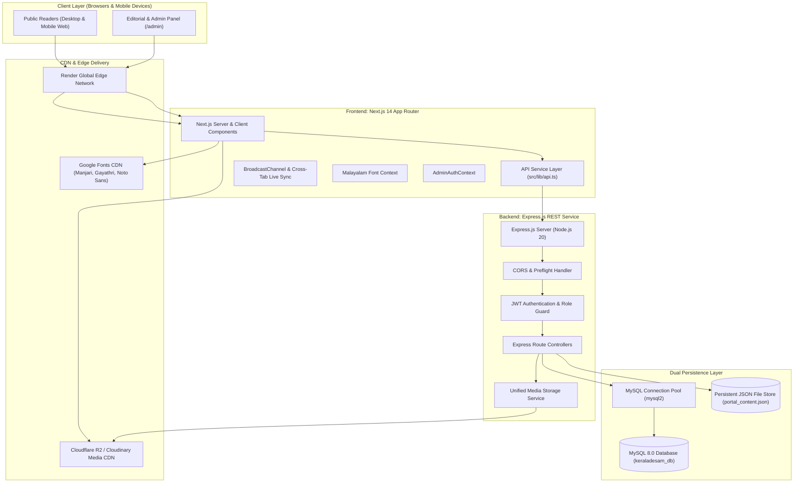
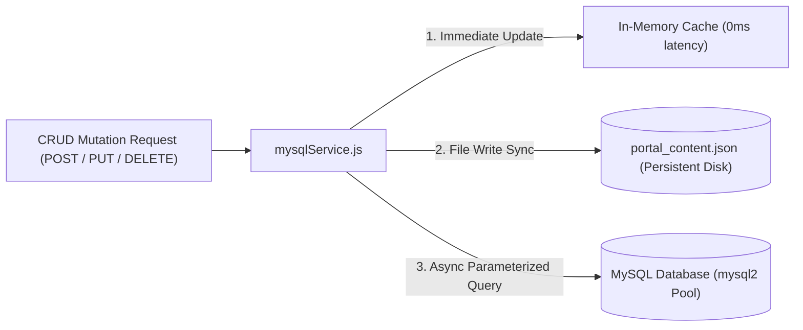

# Kerala Desam (കേരളദേശം) – System Architecture Documentation

**Kerala Desam** is a modern, high-performance, full-stack Malayalam news and journalism portal. The platform delivers instant breaking news, categorized editorial articles, district-level reporting, video shorts, photo features, currency exchange rates, Malayalam text-to-speech audio narration, and an interactive Malayalam E-Paper.

This document describes the complete architectural design of the Kerala Desam system, covering the Frontend, Backend, Database, Media Storage, Authentication, and Deployment layers.

---

## 1. High-Level System Architecture Diagram



---

## 2. Frontend Architecture (Next.js 14 App Router)

The frontend is built using **Next.js 14.2.35** with the **App Router** (`src/app/`), **React 18.3.1**, **TypeScript 5.6.3**, and styled with **Tailwind CSS 3.4.14**.

### 2.1 Architectural Highlights
- **Hybrid Component Model**: Static Server Components render SEO metadata, structured layouts, and fallback templates, while interactive Client Components (`'use client'`) handle real-time tickers, modal dialogs, audio playback, bookmarks, and admin management.
- **Hydration Safety**: Client-only states (browser `localStorage`, dynamic time formatting, audio player state, window dimensions) are deferred until after initial client mount using `useEffect` with mounting flags, preventing React Hydration Mismatches (#418, #425, #423).
- **Responsive Layout**: Designed for mobile-first journalism consumption, featuring a sticky category strip, breaking news marquee ticker, swipeable multi-photo carousels, and a drawer-based mobile navigation menu.

### 2.2 Directory Structure
```
keraladesyam/
├── next.config.mjs               # Next.js configuration & image domains
├── tailwind.config.ts            # Kerala Desam editorial design system theme
├── tsconfig.json                 # TypeScript compiler configuration
├── package.json                  # Frontend dependencies
├── public/                       # Static public assets (logos, favicons)
└── src/
    ├── app/                      # Next.js 14 App Router routes
    │   ├── layout.tsx            # Global Root Layout (Header, Footer, Providers)
    │   ├── page.tsx              # Homepage (Hero, Ticker, Categories, Stories)
    │   ├── globals.css           # Global CSS and custom animations
    │   ├── loading.tsx           # Global loading skeleton
    │   ├── error.tsx             # Global error boundary
    │   ├── not-found.tsx         # Custom 404 page
    │   ├── about/page.tsx        # About Us page
    │   ├── ad-rates/page.tsx     # Advertisement Rates & Inquiry Form
    │   ├── kerala/page.tsx       # District-level journalism page
    │   ├── search/page.tsx       # Global search portal
    │   ├── article/[id]/page.tsx # Article details with TTS audio player
    │   ├── category/[slug]/page.tsx # Category-filtered articles
    │   └── admin/                # Editorial administration portal
    │       ├── page.tsx          # Main Admin Dashboard
    │       ├── login/page.tsx    # Admin login page
    │       └── register/page.tsx # Admin/Editor registration page
    ├── components/               # Modular UI components
    │   ├── Header.tsx            # Main header, ticker & search trigger
    │   ├── Footer.tsx            # Portal footer with newsletter subscription
    │   ├── BookmarksDrawer.tsx   # Offline reading list drawer
    │   ├── EPaperModal.tsx       # Malayalam digital E-Paper reader
    │   ├── LiveTvModal.tsx       # Live TV broadcast player
    │   ├── VideoPlayerModal.tsx  # Video Shorts & Reels modal
    │   └── FontContext.tsx       # Malayalam dynamic typography context
    ├── context/
    │   └── AdminAuthContext.tsx  # JWT authentication session context
    ├── data/
    │   └── newsData.ts           # Type definitions & sample fallback structures
    └── lib/
        └── api.ts                # REST API client & cache management
```

### 2.3 Typography & Dynamic Font Switching
The portal implements an adaptive Malayalam typography system (`src/components/FontContext.tsx`) allowing readers to switch between three leading open-source Malayalam typefaces:
- **Manjari** (Default): Geometric, highly legible modern typeface.
- **Gayathri**: Traditional, editorial aesthetic.
- **Noto Sans Malayalam**: Neutral, dense UI font optimized for small screens.
The reader's font choice and scaling preferences are persisted in `localStorage`.

### 2.4 State Management & Real-Time Live Sync
- **Local State**: Managed with React `useState` and `useReducer`.
- **Global Contexts**: `FontContext` (reader display options) and `AdminAuthContext` (JWT tokens, role status, login state).
- **Zero-Refresh Synchronization**: When content is modified in the Admin panel:
  1. An immediate broadcast is sent via `BroadcastChannel('keraladesyam_live_sync')`.
  2. Local storage keys (`kd_home_articles`, `kd_photo_story`, etc.) are updated.
  3. Custom DOM events (`keraladesyam_articles_updated`, `kd_photo_story_updated`) fire across active tabs.
  4. Homepage and category feeds automatically fetch fresh content without requiring manual page refresh.

---

## 3. Backend Architecture (Express.js REST API)

The backend is built with **Node.js 20** and **Express 4.21.1**, structured following standard Model-Controller-Service patterns.

### 3.1 Backend Directory Structure
```
backend/
├── server.js                     # Express application entry & port fallback
├── vercel.json                   # Serverless deployment configuration
├── package.json                  # Backend dependencies & scripts
├── keraladesam_db.sql            # Master MySQL database schema dump
├── api/
│   └── index.js                  # Serverless function bridge
├── config/
│   └── mysql.js                  # MySQL2 connection pool & automated migration
├── controllers/                  # Route controller logic
│   ├── adController.js           # Ad inquiries CRUD
│   ├── articleController.js      # News articles CRUD & likes
│   ├── authController.js         # User registration & JWT authentication
│   ├── breakingController.js     # Breaking news ticker CRUD
│   ├── photoStoryController.js   # Photo story gallery CRUD
│   ├── subscriberController.js   # Newsletter subscriptions
│   └── videoController.js        # Video shorts CRUD
├── data/
│   ├── portal_content.json       # Persistent file-backed content layer
│   └── seedData.js               # Initial seeding data
├── middleware/
│   └── auth.js                   # JWT verification & role authorization guard
├── routes/                       # Express router specifications
│   ├── adRoutes.js               # /api/ads
│   ├── articleRoutes.js          # /api/articles
│   ├── authRoutes.js             # /api/auth
│   ├── breakingRoutes.js         # /api/breaking
│   ├── cloudflareRoutes.js       # /api/upload & /api/cloudflare
│   ├── forexRoutes.js            # /api/forex
│   ├── photoStoryRoutes.js       # /api/photo-story
│   ├── seedRoutes.js             # /api/seed
│   ├── subscriberRoutes.js       # /api/subscribers
│   ├── ttsRoutes.js              # /api/tts
│   └── videoRoutes.js            # /api/videos
├── scripts/                      # Developer utility & test scripts
│   ├── generate_sql_dump.js      # Database schema & data export script
│   ├── test_http_server.js       # Express HTTP endpoint verification
│   └── test_mysql_endpoints.js   # Direct MySQL service testing
└── services/
    ├── cloudflareService.js      # Cloudflare R2 object storage integration
    ├── mysqlService.js           # Database queries & resilient file persistence
    └── storageService.js         # Multi-provider media upload manager
```

### 3.2 Networking & Host Binding
To ensure compatibility across Windows development environments, Docker containers, and Render cloud hosting:
- Explicit host binding: `HOST = '0.0.0.0'` prevents Windows IPv6 port conflict (`:::5000`).
- Port fallback handling: If port 5000 is occupied, the server automatically catches `EADDRINUSE` and shifts to port 5001.
- CORS Configuration: Supports preflight `OPTIONS` requests, credential forwarding, and multi-origin matching for local and production domains.

---

## 4. Dual Persistence Layer & Database Architecture

The data architecture provides **high availability** and **fault tolerance**:



1. **MySQL 8.0 Primary Store**:
   - Manages relational structures: `users`, `articles`, `breaking_news`, `videos`, `subscribers`, `ad_inquiries`, and `photo_stories`.
   - All database calls use strictly parameterized prepared statements (`?` placeholders) to eliminate SQL injection risks.
   - Connected via `mysql2` connection pool with automatic keep-alive pings.
2. **Resilient JSON File Persistence (`portal_content.json`)**:
   - In ephemeral cloud environments where external MySQL credentials may temporarily lose connectivity or during container restarts, all published articles, breaking tickers, videos, and photo stories are synchronized to disk in `backend/data/portal_content.json`.
   - On server startup, `loadPortalContentFromFile()` rehydrates the in-memory store so that the public portal never serves empty feeds.

---

## 5. Media & Asset Storage Architecture

Media uploads (featured news images, author avatars, and photo stories) are routed through `backend/services/storageService.js`:

1. **Cloudinary (Priority 1)**: Auto-optimizes dimensions, compresses bytes, and delivers via worldwide CDN when API keys are configured.
2. **Cloudflare R2 (Priority 2)**: High-speed S3-compatible bucket storage with zero egress fees.
3. **Resilient Inline Storage (Priority 3)**: For standalone cloud containers without external object storage, images under 400KB are stored as optimized Base64 data URIs or written to `public/uploads/` with persistent JSON fallback.

---

## 6. Authentication & Security Architecture

- **Password Security**: Passwords are encrypted using `bcryptjs` with salt rounds (10) before storage.
- **JWT Authorization**: Admin and Editor sessions issue JSON Web Tokens (`jsonwebtoken`) signed with a secret key.
- **Role-Based Guards**: Protected mutation routes (`POST`, `PUT`, `DELETE`) require the `protect` middleware; role-restricted actions require the `authorize('admin')` guard.
- **Sanitized Identification**: Editorial author labels enforce non-hierarchical designations (scrubbing legacy "Chief" references to ensure standard editor branding).

---

## 7. Deployment Architecture (Render Cloud)

Both frontend and backend are hosted on **Render**:

| Service | Type | Repository | Build Command | Start Command | Public URL |
| :--- | :--- | :--- | :--- | :--- | :--- |
| **Frontend** | Node.js Web Service | `kerala-dhesam` | `npm install && npm run build` | `npm start` | `https://kerala-dhesam.onrender.com` |
| **Backend** | Node.js Web Service | `kerala-dhesam-admin` | `npm install` | `npm start` | `https://kerala-dhesam-admin.onrender.com` |

Continuous Deployment (CD) triggers automatically on git push to the `main` branch of each repository.
